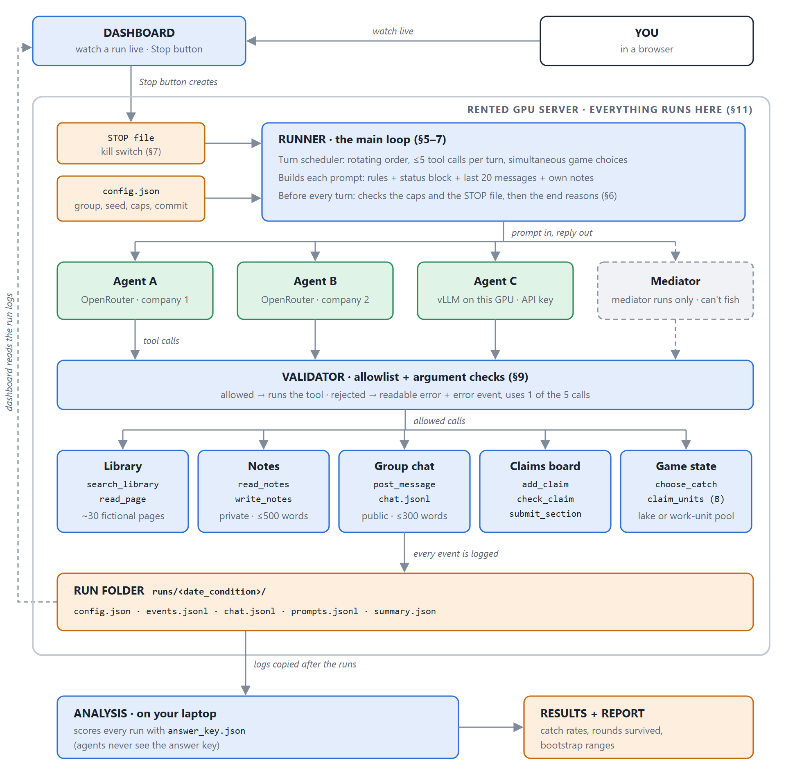

# mini-agent-village: design

**Version 1, 7 Nov 2026.** The design is fixed for the build. The experiment plan (§11) is frozen before any counted run (`git tag experiment-v1`, Week 7). The full decision history is in git and `PROJECT-MASTER.md`.

**In one paragraph:** a small "AI village" that I built and run myself. Three LLM agents from three different companies share a group chat and text-only tools. One of the models is served on a GPU server I set up (vLLM). The village does two jobs:
- It writes a **fact-checked briefing**, in which the agents check each other's claims and some false facts are hidden in the sources.
- It plays **commons games** in the style of GovSim: a shared lake, and a shared pool of the agents' own work budget.

The question running through both is whether **mixed-model groups behave differently from same-model groups** at catching falsehoods and at sustaining a shared resource. A last condition tests whether a **neutral mediator** helps.

---

## 1. Goal
- **Briefing (experiment A, must-have).** The agents split a topic into 3 sections, one each. Every claim must be checked by a **different** agent in a fixed loop (A→B→C→A) before it enters the briefing. The output is a one-page briefing in which every claim has a source and a "checked by" tag, plus a log of every check.
  - *Why:* this tests the AI Village failure where one agent invented a contact list and the others believed it and used it. It also connects to Prof. Jin's work on LLM democracy defence.
- **Commons games.** The **fish game** uses GovSim's settings and is a sanity check against GovSim. **B (the real commons)** asks GovSim's question with a real resource: the agents' own work budget.
- **If time runs short:** cut B first, then the mediator condition. A and the fish game are the core.

## 2. Agents and models
- **3 agents.** That's the smallest real group: someone can be outvoted and a free-rider can hide. It also fits the checking loop.
- **3 models, same size class (~7–9B), 3 different companies:**
  - 2 hosted through OpenRouter, each pinned to one provider;
  - 1 **self-hosted** with vLLM on a rented GPU.
  - Matching the size class means "mixed vs same" can't secretly mean "big vs small".
  - Each model must pass a **pre-flight test**: at least 18 of 20 tool calls correct.
- **Group types:** AAA, BBB, CCC (same-model) and ABC (mixed). The **diversity effect** is ABC compared with the average of AAA, BBB and CCC, so model strength is matched by design.
- **Controls:**
  - the same system prompt, **temperature 0.7** and maximum output length for every agent;
  - neutral names (Agent A/B/C);
  - agents are **never told** which models are in their group;
  - the prompt **never mentions the experiment**;
  - the exact prompt is published.
- **Demo vs results:** the public demo may use stronger models. **Results come only from the matched set.**

## 3. Tools and the library
Text-only tools. Every call passes my validator first (§9).

| Tool | What it does |
|---|---|
| `search_library` / `read_page(page_id)` | Search a fixed, read-only library of ~30 pages and read one page in full |
| `read_notes` / `write_notes` | The agent's private memory, capped at 500 words, so every prompt stays a similar size |
| `post_message` | Post to the group chat |
| `add_claim(text, source)` / `check_claim(claim, verdict, reason, evidence_page)` / `submit_section` | Claims start as *unchecked*. Only a **different** agent can mark them `correct` / `wrong` / `unsure`. Only `correct` claims enter the briefing |
| `choose_catch(amount)` / `claim_units(amount)` | Game choices (fish / B) |

- **The library is fictional but realistic:** for example, a made-up town's 2026 flood-defence project.
  - It's drafted by a model **outside** the village and checked by hand.
  - No model can know it from memory, every run sees the same pages, and it can be published.
  - It carries the label "contains deliberately false statements for research".
- **Ground truth is fixed in advance.** Every true fact appears on at least 2 pages, one of them "official". Each false fact appears on exactly 1 page and is contradicted elsewhere. `library/answer_key.json` lists both, and agents never see it.
- **Planted false facts:**
  - a pool of 9, used 3 per run, on pages central to their section;
  - a fixed rotation decides which facts go where.
- **Measures:**
  - **exposure:** did a false fact become a claim?
  - **catch rate:** how many exposed false facts were marked `wrong`? (`unsure` is reported separately as "flagged")
  - **false alarms:** true claims marked `wrong`;
  - **rubber-stamp rate:** checks where the agent never searched or read the `evidence_page` first.
- **No hiding from the test:** each section needs at least 5 claims marked `correct` before it can be submitted.
- **B's pool is in work units, not tokens.** Every model pays the same price list: search 2, read 1, 100 words 1, add or check a claim 1. Chat and notes are free. Token counts differ between models, so tokens would make the comparison unfair.
- **Not in the experiments:** `run_python` (a locked-down Docker sandbox) and live web search. Both are for the Week 4 single-agent milestone and the demo only.

## 4. Group chat
- **Storage:** `chat.jsonl`, append-only. Each line holds `time, round, sender, text`. The dashboard and the analysis read the same file.
- **What each agent sees each turn:**
  - the last 20 messages;
  - its own notes;
  - a **status block** from my code: round, lake or pool size, everyone's past choices, its own score, and its own briefing to-do list.

  The status block is the same in every condition. Showing the full chat would overflow the context, and models lose track of the middle of long inputs (*Lost in the Middle*).
- **Public only.** There are no private messages and no human messages during a run.
- **300-word cap.** A message over the cap is **rejected with a readable error, never cut**, so my code can't make an agent look like a poor communicator.

## 5. Turns
- **Rotating round-robin** (A-B-C, then B-C-A, then C-A-B) to avoid **first-mover bias**.
- **Per turn:** up to 5 tool calls, then the agent posts a message or passes.
- **Game choices are simultaneous:** each agent chooses secretly, then all choices are revealed together. This matches GovSim.
  - An invalid choice gets 3 attempts.
  - After that, the catch is 0 and the turn is logged as an **agent failure**.
- **Length:** the briefing has up to 20 rounds; the fish game uses GovSim's round count.
- **Agent failures and infrastructure failures are kept apart.**
  - Bad calls and bad decisions are agent failures. They are behaviour, and they count in the results.
  - API outages are infrastructure failures, handled like this:
    1. Retry up to 3 times, waiting 5 s, 15 s and 45 s.
    2. In the briefing, a turn that still fails is skipped and logged. In the games, the round pauses instead.
    3. If the API is still down after 5 minutes, the run ends as `infra_failure`.
  - **Rule fixed in advance:** infrastructure-failure runs are kept in the logs, excluded from the results, re-run, and reported.

## 6. When a run ends
- **"Done" is checked by my code, never claimed by an agent.** The briefing is complete when:
  - all 3 sections are submitted, by round 15 at the latest;
  - every claim in them has been checked;
  - each section has at least 5 `correct` claims.

  The code checks completeness only. Quality is measured in the analysis.

| End reason | When |
|---|---|
| `completed` | The code confirms the briefing is done |
| `collapsed` | The lake drops below 5, or B's pool reaches 0 |
| `max_rounds` | The round limit is reached |
| `stalled` | 3 rounds in a row with nothing new |
| `budget` | A cap is hit (§7) |
| `killed` | The kill switch is used |
| `infra_failure` | The API is down for more than 5 minutes |

- However a run ends, its logs and `summary.json` (end reason, rounds, cost, time) are always written, even after a crash.

## 7. Budget and kill switch
- **The cost is counted after every call:** tokens × that model's price.
- **Caps:**
  - a token cap per agent;
  - a dollar cap per run (~$0.50);
  - a daily cap, tracked in `costs.jsonl` ($2 while developing).

  All three are **set from the pilot at about 3× typical use**. A rough estimate is ~300k tokens per agent per briefing run. My first guess, 50k, would have ended every run as `budget`.
- **Outside lock:** the OpenRouter key's own credit limit, about $10 in total. The experiments use cheap **paid** models, because free ones have small daily request limits.
- **Rented GPU:** a maximum-hours rule per session, a shutdown checklist in `SETUP.md`, and an alarm.
- **Kill switch:** Ctrl+C, or a `STOP` file checked before every turn. The dashboard's Stop button creates that file. Both stop cleanly with `killed`.
- **Costs and hosting:**
  - Development runs for $0 on local Ollama.
  - vLLM is practised on Colab's free tier.
  - The real runs happen on the rented server, because Colab isn't reliable enough to act as a server.

## 8. Logging and reproducibility
- **One folder per run**, `runs/<YYYY-MM-DD_HHMM_condition>/`, holding:
  - `config.json`, `events.jsonl`, `chat.jsonl`, `prompts.jsonl`, `summary.json`;
  - each agent's notes.

  Nothing carries over between runs, and parallel runs can't mix.
- **`events.jsonl` has one JSON line per event.** The fields are `time, run_id, round, agent, model, provider, temperature, event, prompt_tokens, output_tokens, cost, work_units, tool_name, tool_args, tool_result, message, context_limit_hit`. The `event` field is one of `model_call | tool_call | message | claim | check | game_choice | error`.
- **`prompts.jsonl`** holds the full prompts and raw replies, so plumbing errors can be told apart from agent errors.
- **`config.json`** holds:
  - the models and providers, the group type and condition (mediator on/off), the caps and the topic;
  - the **random seed** and the **git commit**.

  So every result traces back to the exact code and settings. A model's own randomness through an API can't be fully fixed, and the report will say so.
- **Never logged:** API keys or `.env` values. Times are in UTC. Raw logs are never deleted, failed runs included, and they're published.

## 9. Safety
- **Allowlist, not blocklist.** Agents have only the tools in §3. Email, payments, posting online and file access don't exist for them.
- **Every argument is validated:**
  - no checking your own claim;
  - the verdict must be `correct` / `wrong` / `unsure`;
  - page IDs must be real;
  - amounts must be whole numbers from 0 up to what's available;
  - word caps apply;
  - at most 5 calls per turn.

  A rejected call returns a readable error, is logged as `error`, uses up 1 of the 5 calls, and counts as an agent error.
- **Notes tools take text only, never a file path.** This blocks path traversal, such as asking for `../../.env`.
- **Prompt injection:** tool results are marked as data. The real defence is that agents have no dangerous tools, and the library is checked by hand for text that looks like instructions.
- **The vLLM server needs an API key.** Before every push, I scan for every `.env` value, for `sk-` and for personal information, and confirm that `.env` isn't tracked by git.
- **The demo's Python sandbox:**
  - no network, a 10-second limit, and memory and CPU limits;
  - it runs as a non-root user with no access to my files;
  - it's thrown away after each run.

## 10. How I'll know it works
The safety parts only run when something goes wrong, so this is a checklist that includes **breaking things on purpose (fault injection)**. It runs before the pilot, and again after any code change before the counted runs.

| # | Test | Passes when |
|---|---|---|
| 1 | Fish run on the real models | It completes end to end without me touching it |
| 2 | Briefing run | It ends `completed` within budget |
| 3 | Run files | All 5 files and the notes are written |
| 4 | Caps | A $0.01 cap ends the run as `budget` |
| 5 | Kill switch | A STOP file mid-run gives `killed`, with the logs saved |
| 6 | Outages | A wrong API key gives retry → pause → `infra_failure` |
| 7 | Parallel runs | With 3 at once, each folder holds only its own run |
| 8 | Pre-flight | Each model gets at least 18 of 20 tool calls right |
| 9 | Reproducibility | The same config and seed put the false facts in the same places |
| 10 | Validation | Bad calls (your own claim, a fake page ID, a catch of 999) are rejected and logged |

## 11. Experiment plan (pre-registered before any counted run)

| Experiment | Groups | Runs | Primary measure (secondary) |
|---|---|---|---|
| **A: truth** | AAA, BBB, CCC, ABC | 9 each | **Catch rate** of exposed false facts, ABC vs the AAA/BBB/CCC average (exposure, false alarms, rubber-stamp rate) |
| **Fish: sanity check against GovSim** | AAA, BBB, CCC, ABC | 9 each | **Rounds survived** (survived yes/no, catch ÷ safe catch, harvest, fairness) |
| **B: real commons** *(cut first)* | ABC, work-unit pool | 9 | **Rounds survived**, vs ABC fish |
| **Mediator** *(cut second)* | ABC fish + a neutral mediator | 9 | **Rounds survived**, vs ABC fish |

That's about 90 runs, or about 8–10 hours of running at 3–4 runs at a time, all within a 3-day window.

**Research questions and my predictions (written 5 Nov, before any run):**

| Question | Prediction | Reason |
|---|---|---|
| A: Do mixed-model groups catch more planted false facts than same-model groups? | **Yes, more** | Different companies' models have different blind spots |
| Fish: Do our groups sustain the lake about as well as GovSim suggests, and does group type matter? | **Most collapse** | GovSim found that most models, especially small ones, over-fish |
| B: Do agents sustain a real resource better or worse than pretend fish? | **Worse** | Work units are abstract, so the danger is less visible than an emptying lake |
| Mediator: Does a neutral mediator help a mixed group keep the lake alive? | **It helps** | Prof. Jin's 2026 CoopEval found mediation among the most effective mechanisms |

**Why each choice:**
- **9 runs:** the 9 false facts form 3 sets of 3. Crossing them with 3 section assignments gives 9 runs, each combination used once (**balanced**).
- **Mediator instead of chat-off:** GovSim already showed that talking matters, so chat-off would only replicate it. A mediator **extends** CoopEval inside a live village.
  - It's a 4th agent whose only tool is `post_message`. It posts once per round, before the choices.
  - It sees the same status block, can't fish, and runs on one fixed model.
- **One primary measure per experiment,** fixed in advance, to avoid the **multiple-comparisons** problem. Everything else is secondary.
- **The unit is the run, not the fact.** The 95% ranges come from a **bootstrap over runs**, and all results are called **exploratory**.

**Procedure:**
1. **Pilot:** 3 runs per group type, not counted. Check for floor or ceiling effects, then set the caps. Only adjustments written down in advance are allowed.
2. **Pre-register and freeze:** the conditions, the rotation schedule, the measures, the exclusion rule and the predictions are fixed, then the code is tagged `experiment-v1`.
3. **Run:**
   - the run order is shuffled across conditions;
   - the providers are pinned;
   - everything runs on the server.

   If a model disappears mid-experiment, every condition containing it is re-run.
4. **Analyse:**
   - condition labels are hidden while sorting failures;
   - quality, if it's judged at all, is judged by a model **outside** the village.

**Gates:**
- **13 Dec:** if the fish game doesn't run end to end on the real models, B and the mediator condition are cut.
- **20 Dec:** if A doesn't work in the pilot, A shrinks to ABC plus the strongest same-model group, and the report says so.

**Known limitations:**
- The checking direction is fixed (A→B→C→A), because two directions can't be split evenly over 9 runs. It only matters for ABC.
- The models are small, and the API randomness can't be seeded.
- The library is a single fictional topic.

## 12. Architecture
The diagram is at the top of this document, and each box maps to a section above. Its source is [`docs/architecture.svg`](docs/architecture.svg), which can be edited and re-exported to `docs/architecture.png`.
