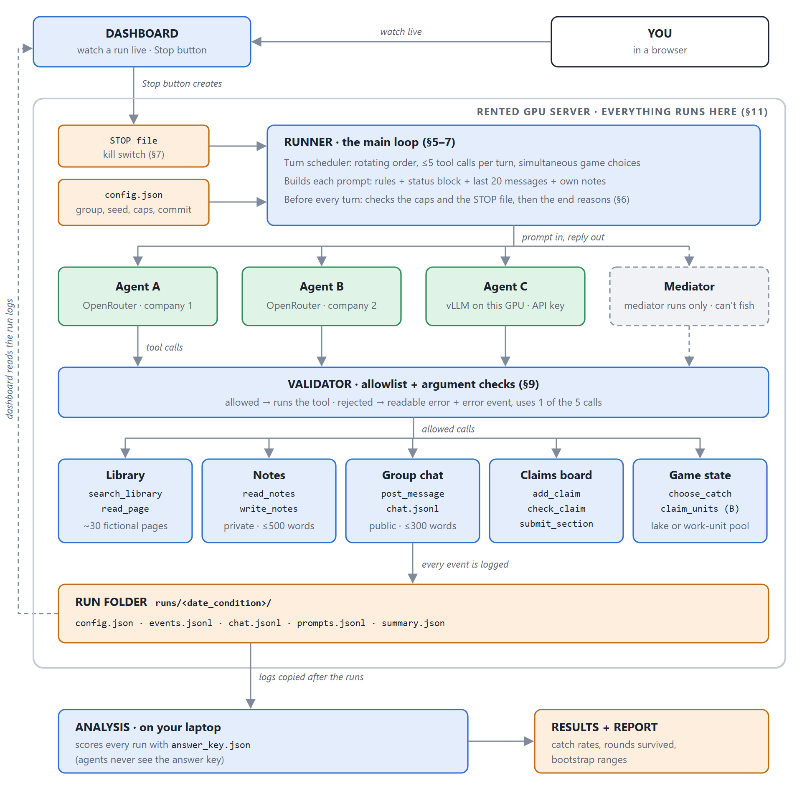

# mini-agent-village

A small multi-agent LLM "village" that I'm building and running myself, so I can run careful experiments on two questions:
- Do AI agents **catch each other's false claims**?
- Do they **share a common resource** or over-use it until it collapses?

Inspired by AI Digest's [AI Village](https://theaidigest.org/village) and by GovSim [1].

**Status (7 Nov 2026): design complete; the build starts 16 Nov.**
- Done:
  - a tool-calling agent loop (on a local model and on a hosted model);
  - nanoGPT trained from scratch;
  - the [design doc](DESIGN.md) and architecture.
- Next: serving my own model with vLLM on a rented GPU.



## The idea
Three agents run models from **three different companies**, all in the same size class (~7–9B). One of the models is **self-hosted**. The agents share a group chat and text-only tools, and every tool call passes a validator first. The village has two jobs:

1. **Truth (experiment A).** The agents write a briefing from a fictional library in which false facts are hidden. Every claim must be checked by a different agent. *Do mixed-model groups catch more false facts than same-model groups?*
2. **Commons (fish game, B, mediator).**
   - A GovSim-style shared lake.
   - A version where the shared resource is the agents' own work budget (B).
   - A version with a neutral mediator agent, following CoopEval [2].

   *Do groups sustain the resource, and does group type or a mediator matter?*

**Predictions** are written down before any run, together with one primary measure per experiment, the exclusion rules and the run schedule (see [DESIGN.md §11](DESIGN.md#11-experiment-plan-pre-registered-before-any-counted-run)). The experiment code is frozen with a git tag before any counted run, and every run is logged and published, failed runs included.

## What's in the repo

| Path | What it is |
|---|---|
| [`DESIGN.md`](DESIGN.md) | The full design: agents, tools, safety, logging, tests, experiment plan, predictions |
| [`docs/architecture.png`](docs/architecture.png) | The architecture diagram (source: `docs/architecture.svg`) |
| [`week1/agent.py`](week1/agent.py) | A tool-calling agent loop (calculator + date tools) on a local model through Ollama (`qwen2.5:3b`) |
| [`week1/agent_hosted.py`](week1/agent_hosted.py) | The same loop on a hosted model through OpenRouter |
| [`week2/nanogpt_shakespeare.ipynb`](week2/nanogpt_shakespeare.ipynb) | nanoGPT trained from scratch on Tiny Shakespeare (Colab T4, 10.6M parameters). Best val loss 1.46 at step 1750; overfitting after that, handled by early stopping |
| [`NOTES.md`](NOTES.md) | A dated dev log: what I did, what broke, what I learned |

## Run the Week 1 agents
```bash
python -m venv .venv
.venv\Scripts\activate          # Windows; on macOS/Linux: source .venv/bin/activate
pip install -r requirements.txt

# Local model (free): install Ollama, then
ollama pull qwen2.5:3b
python week1/agent.py

# Hosted model: copy .env.example to .env and add an OpenRouter key
python week1/agent_hosted.py
```

## Roadmap
| When | Milestone |
|---|---|
| Nov 2026 | Self-host a 7–8B model with vLLM (setup timings in `SETUP.md`) · one strong agent · the fictional library + answer key |
| Early Dec | Village core + fish game · dashboard · claim tools |
| Mid Dec | Pilot, caps set from the pilot, pre-registration frozen (`experiment-v1`) |
| Late Dec | ~90 runs on the server |
| Jan 2027 | Analysis (bootstrap over runs, blinded failure sorting) and a technical report |

## References
1. Piatti et al. (2024). *Cooperate or Collapse* (GovSim). NeurIPS. [arXiv:2404.16698](https://arxiv.org/abs/2404.16698)
2. Tewolde et al. (2026). *CoopEval.* [arXiv:2604.15267](https://arxiv.org/abs/2604.15267)
3. Karpathy. [nanoGPT](https://github.com/karpathy/nanoGPT) (MIT licence)

## Licence
[MIT](LICENSE)
